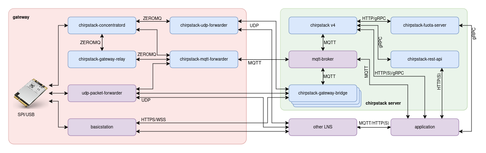

# ChirpStack MQTT Forwarder service for Docker

This is an **unofficial** build of the ChirpStack MQTT Forwarder service meant to be deployed using docker. The binaries included with this image are built from the chirpstack-mqtt-forwarder fork at https://github.com/xoseperez/chirpstack-mqtt-forwarder and may have small differences with the original binaries (check the repo for more info).

Please refer to the original sources of the project whenever possible, contribute and donate to Orne for his great work: https://github.com/chirpstack/chirpstack-mqtt-forwarder

ChirpStack MQTT Forwarder is an open-source LoRa(WAN) packet forwarder using MQTT as transport protocol, part of the ChirpStack project. It requires a chirpstack-concentratord component, or a Semtech UDP packet forwarder, in order to build a viable LoRaWAN gateway solution.



## Tags

Each release of the fork (`v<upstream version>-r<n>`) is published as:

Tag | Points to
--- | ---
`4.6.1-r1` | that release (never changes)
`4.6.1`, `4.6`, `4`, `latest` | the newest release

Every tag is a multi-arch image for `linux/amd64`, `linux/arm64` and `linux/arm/v7`, and Docker picks the right one. The per-architecture tags (`amd64-latest`, `aarch64-latest`, `armv7hf-latest`) are no longer published.

## Chirpstack MQTT Forwarder service variables

These variables you can set them under the `environment` tag in the `docker-compose.yml` file or using an environment file (with the `env_file` tag).

Variable Name | Value | Description | Default
--- | --- | --- | ---
**`LOGGING_LEVEL`** | `STRING` | One of `TRACE`, `DEBUG`, `INFO`, `WARN` or `ERROR` | `INFO`
**`MQTT_TOPIC_PREFIX`** | `STRING` | Topic prefix, defines the region of the gateway | `eu868`
**`MQTT_SERVER`** | `STRING` | MQTT broker address `<scheme>://<domain or ip>:<port>`, scheme being `tcp`, `ssl`, `ws` or `wss` | `tcp://mosquitto:1883`
**`MQTT_USERNAME`** | `STRING` | MQTT broker user name | *empty*
**`MQTT_PASSWORD`** | `STRING` | MQTT broker user password (not shown in the log) | *empty*
**`MQTT_QOS`** | `0`, `1` or `2` | MQTT quality of service | `0`
**`KEEPALIVE_INTERVAL`** | `INT` | Maximum time without traffic to the broker, in seconds | `30`
**`MQTT_CA_CERT_PATH`** | `STRING` | Path to MQTT broker root certificate | *empty*
**`MQTT_CLIENT_CERT_PATH`** | `STRING` | Path to MQTT client certificate | *empty*
**`MQTT_CLIENT_KEY_PATH`** | `STRING` | Path to MQTT client key | *empty*
**`MQTT_JSON`** | `false` or `true` | Send messages using JSON instead of Protobuf (only for debugging!) | `false`
**`BACKEND`** | `STRING` | Backend type, either `concentratord` or `semtech_udp` | `concentratord`
**`SOCKET_NAME`** | `STRING` | Prefix of the IPC socket when using the `concentratord` backend (same as in the `concentratord` service) | `concentratord`
**`BACKEND_UDP_BIND`** | `STRING` | Address to listen to UDP messages when using the `semtech_udp` backend | `0.0.0.0:1700`
**`BACKEND_FILTER_DEVADDR`** | `STRING` | Comma-separated DevAddr prefixes to forward uplinks for, e.g. `0000ff00/24` | *empty* (no filter)
**`BACKEND_FILTER_JOINEUI`** | `STRING` | Comma-separated Join EUI prefixes to forward join requests for, e.g. `0000ff0000000000/24` | *empty* (no filter)

The image runs as user `nobody`, so certificate files (for instance docker secrets) must be readable by it. With the `semtech_udp` backend, publish the UDP port (`1700:1700/udp`) so packet forwarders can reach it.

These older names still work, with a warning in the log:

Old name | Use instead
--- | ---
`BACKEND_SOCKET_NAME` | `SOCKET_NAME`
`KEEP_ALIVE_INTERVAL` (a duration, such as `30s`) | `KEEPALIVE_INTERVAL` (in seconds)

To see the configuration a set of variables produces, without starting the forwarder:

```sh
docker run --rm -e MQTT_SERVER=tcp://broker:1883 xoseperez/chirpstack-mqtt-forwarder bash start --render
```

## Use

Check the included `docker-compose.yml` file for a usage example.

## Building

The image packages the release tarballs of the fork; it compiles nothing. From the root of the repository:

```sh
# Get the binaries: build them, or download the tarballs of a release
make dist-x86_64-unknown-linux-musl
# gh release download v4.6.1-r1 --pattern 'chirpstack-*.tar.gz' --dir dist

docker buildx bake -f docker/docker-bake.hcl --load --set '*.platform=linux/amd64'
```

`dist/` must hold exactly one tarball per architecture being built; `--set '*.contexts.dist=<folder>'` takes them from another folder (outside the repository, also pass `--allow=fs.read=<folder>`). Set `REGISTRY` and `VERSION` to name the image differently, and use `--push` instead of `--load` to push it.

Releases are built, tested and pushed to Docker Hub by `.github/workflows/docker-release.yml`, when a fork release is published or when the workflow is run by hand.

## License

ChirpStack MQTT Forwarder is distributed under the MIT license (and so is this repository). See LICENSE.
